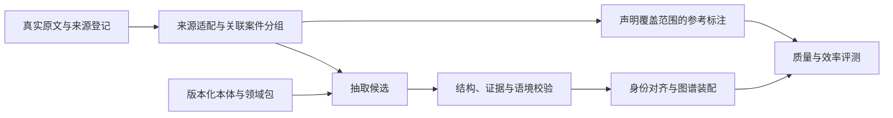

# 新架构与迁移边界

状态：继承已确认的 P0 研究目标，当前只实现环境与资料完整性工具。下列业务模块是设计，不是已完成实现。

| 边界 | 职责 | 计划位置 |
|---|---|---|
| 来源 | 原文件哈希、版本/文件/记录/字段定位、派生偏移 | `src/judicial_kg/sources/` |
| 本体 | 通用概念、民间借贷领域定义、结构契约 | `ontology/`、`schemas/` |
| 抽取 | Qwen 协议适配、提示版本、原输出、失败记录 | `src/judicial_kg/extraction/` |
| 校验 | 字段、引用、端点、否定和陈述归属 | `src/judicial_kg/validation/` |
| 装配 | 案件内身份、节点/边/事件/主张/来源记录 | `src/judicial_kg/graph/` |
| 评测 | 固定一对一匹配、TP/FP/FN、覆盖与效率 | `src/judicial_kg/evaluation/` |

这些目录随首个实际实现创建。首版契约优先 YAML/JSON Schema；没有选择完整 OWL 推理或 SHACL 作为必需依赖。先输出存储无关的记录，再决定数据库适配。当前环境无需 Neo4j、PostgreSQL、向量库或 GPU。

本次迁入旧设计与数据登记，保留固定提交和哈希。旧 `src/`、拼接文书、图数据库、QA 产物和既往分数保留在旧仓库，不形成新项目基线。旧 `p0/datasets/` 中的审计脚本仍可从固定提交复现；需要迁移时逐项确认输入、输出和依赖，再落入新结构，不整体复制旧运行环境。

领域语义必须区分 Actor/Mention、角色与类型、事件与成立状态、当事人主张/法院转述/法院认定。金额用定点值并保留原文，时间未知不补齐。同名、脱敏占位符与数据内 ID 都不自动建立跨案主体身份。

原始字节 → 发布字段 → 派生文本各有偏移空间。字段拼接后的字符偏移不能称为原法院文书偏移。图谱结构合法不等于语义正确。
