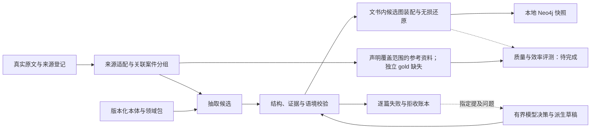

# 新架构与迁移边界

状态：当前已实现环境、资料完整性、两类来源适配、开发数据准备、保守分组、证据回放、开发版最小本体与抽取契约校验，以及本地 Qwen / 百炼小批抽取适配器。保留语境的候选图装配已实现；正式语义评测仍未实现；结构检查不等于完整数据准入或法律语义核验。见 [来源开发](source-development.md)、[本体契约](ontology-contract.md)、[本地抽取](qwen-extraction.md) 与 [候选图装配](graph-assembly.md)。

| 边界 | 职责 | 计划位置 |
|---|---|---|
| 来源 | 原文件哈希、版本/文件/记录/字段定位、派生偏移 | `src/judicial_kg/sources/` |
| 本体 | 通用概念、民间借贷领域定义、结构契约 | `ontology/`、`schemas/` |
| 抽取 | Qwen 协议适配、提示版本、原输出、失败记录 | `src/judicial_kg/extraction/` |
| 校验 | 字段、引用、端点、否定状态结构和陈述归属约束 | `src/judicial_kg/validation.py`、`validation_run.py` |
| 装配 | 案件内身份、节点/边/事件/主张/来源记录 | `src/judicial_kg/graph/` |
| 评测 | 固定一对一匹配、TP/FP/FN、覆盖与效率 | `src/judicial_kg/evaluation/` |

来源模块、首版 JSON Schema 契约、`extraction/` 与 `graph/` 已实现；未实现目录随实际代码创建。本体词表放 `ontology/`，结构契约放 `schemas/`，生成与加载逻辑位于 `contracts.py`。按用户最新决定，后续本地抽取采用 SSH stdin 到现有 Spark loopback 服务；百炼仅保留历史适配与试跑，密钥留在本地私密环境文件。程序提供无损来源片段，模型选择证据及语境，程序生成坐标、继承关联、类型与保守归一化，不让模型填写来源哈希；可离线重放原响应。没有选择完整 OWL 推理或 SHACL 作为必需依赖。候选图保持存储无关，并已实现独立 Neo4j CSV 快照导出及本地展示。有界提及修复保留原响应和决策，只修改允许的选择器/提及；修复后重走完整契约，不能自动把拒收项变成通过。离线契约验证无需 Neo4j、PostgreSQL、向量库或 GPU。

本次迁入旧设计与数据登记，保留固定提交和哈希。旧 `src/`、拼接文书、图数据库、QA 产物和既往分数保留在旧仓库，不形成新项目基线。旧 `p0/datasets/` 中的审计脚本仍可从固定提交复现；需要迁移时逐项确认输入、输出和依赖，再落入新结构，不整体复制旧运行环境。

领域语义必须区分 Actor/Mention、角色与类型、事件与成立状态、当事人主张/法院转述/法院认定。金额用定点值并保留原文，时间未知不补齐。同名、脱敏占位符与数据内 ID 都不自动建立跨案主体身份。

原始字节 → 发布字段 → 派生文本各有偏移空间。字段拼接后的字符偏移不能称为原法院文书偏移。图谱结构合法不等于语义正确。

## 首轮预防与独立校验

首轮提示先约束真实提及、名称逐字复制、法院类型、陈述者局部属性和参与角色方向。程序校验仍是必经步骤：JSON 完整不代表证据位置正确，工程通过也不代表法律语义正确。v8 在固定 10 篇开发文书上重新从原文生成，旧修复候选不作为输入；本轮执行结果见 progress.md 的最新记录。

失败处理按实际原因分开：截断输出保留原响应，需要按来源重抽，不能补齐 JSON 后称为成功；完整但引用错误的草稿可进入冻结选择目录的有界修复；语境类型、主体类型及属性归属使用各自明确的修改边界。每次修改都重新走完整校验并可零调用回放。不确定项保留拒收，首轮统计不随修复改写。

事件参与角色另有只读诊断 `graph/participants.py`：在单个事件及其语境内检查角色配对、同主体相反角色和借贷/转账角色词表混用。诊断不补齐参与者、不根据同金额合并事件、不跨主张与法院认定推断身份，也不修改候选。提示表示需要复核，不表示原文错误或已确认漏抽；不能据其数量计算准确率或召回率。
