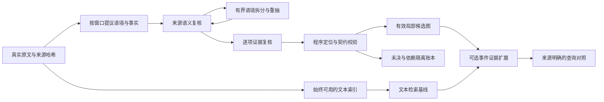

# 当前主流程：current-rc1

这是收敛候选版，不是已经证明语义准确或检索增益的生产最终版。唯一开发入口为 `judicial-kg current`（也可 `PYTHONPATH=src .venv/bin/python -m judicial_kg.current.cli`）。旧 v1–v44 命令保留用于复现实验，不再作为新增能力的默认入口。



## 收敛内容

| 保留能力 | 当前模块 |
| --- | --- |
| 原文哈希、真实来源及精确跨度 | source / 既有来源契约 |
| 完整称谓的可逆空白定位，不拆单字拼姓名 | source.locate |
| 主体、集合、对象、主张/认定、极性与事件分离 | protocol / compiler / 契约0.5 |
| 来源语义复核、可拆分的有界语境重抽及原候选去向账本 | semantics / runner.compile_with_recovery |
| 提议与证据复核分开，固定原文单元选择 | runner.verify |
| 对齐任务共享原文与候选目录，程序无损展开验证 | shared / FlashAlignmentCalls |
| 原文有效性与图谱往返 | 既有validation、graph assembly |
| 局部失败隔离、依赖拒收和未决账本 | Compiler.attempt / coverage / issues |
| 冻结输入、零调用回放、共享累计预算 | current.cli / SharedBudget |
| 原文检索、BM25、词法TF-IDF、混合检索与事件证据扩展 | retrieval |
| 有来源参考的离线检索对照 | evaluate；无参考项明确不计分 |

## 流程与评价边界

1. 所有输入原文先入文本索引，即使未选做图谱或模型失败，仍能检索。
2. 原文按固定连续单元窗口处理。窗口不是法律语境；给模型完整原文作背景，仅目标窗口允许作为本轮事实证据。
3. 使用中文接口提议语境、主体、集合、对象、角色、事件和原文值；正式ID、证据哈希、偏移全部由程序生成。
4. 默认先独立调用检查来源语义：实际说话者、法院/当事人框架、嵌套转述、否定对象及属性含义。失败语境最多两轮模型重抽，可拆成多个语境；每个原角色/事件/陈述及既有未决登记去向，原值不能替换。原文线索不是已核验的框架标签。随后同模型逐项检查直接证据；两种复核都不是专家gold。
5. 各实体/断言独立事务校验。不存在的依赖只拒收相关项；未知集合成员不需要虚构，集合事件不传播到成员。未知说话者仍不能冒充明确当事人主张。
6. 每个原文单元保留处理记录：processed / no_relevant_content / uncertain / failed；前三者是模型或流程记录，不能称为召回率。
7. 生成局部候选图并无损回放。partial不是完整通过，历史0/3不改写。engineering_complete也只表示本协议未触发拒收，不证明语义完整。

新增复核只能降低已知风险，角色与集合成员身份、观点归属及反事实/否定仍可能判断错误；严格来源只能排除不存在的引文。跨窗口关系与跨语境身份合并目前不自动解决，明确保持局部身份，不能当全局实体图。当前仅为角色/事件/属性的有限本体；无法表达的内容必须保留unresolved及原文。

## 使用

```bash
# 不需要模型或密钥：将规范化来源文书JSON数组建为原文索引。
PYTHONPATH=src .venv/bin/python -m judicial_kg.current.cli index \
  --documents artifacts/sources/documents.json --output artifacts/current/text-index.json

# 默认连续原文窗口检索；图谱扩展需显式 --method graph_augmented --candidate ...。
PYTHONPATH=src .venv/bin/python -m judicial_kg.current.cli search \
  --index artifacts/current/three-02/text-index.json --query '借款 还款'

# 新抽取需新输出目录、核对输入哈希及更新累计预算后的新manifest。
PYTHONPATH=src .venv/bin/python -m judicial_kg.current.cli run \
  --manifest artifacts/current/new-manifest.json --output artifacts/current/new-run \
  --credential-root ../judicial-ontology-kg-current --execute

# 回放必须使用该次运行冻结的实现；历史three-02对应32f6863。
PYTHONPATH=src .venv/bin/python -m judicial_kg.current.cli replay \
  --source-run artifacts/current/new-run/document-01 --output artifacts/current/replay-extra
```

检索对照输入是带来源的 JSON 数组：每项 `id`、`query`、`relevant_document_ids`。这只评估上游参考文书命中，不是专家类案相关性或答案准确率。通过 `evaluate --index ... --questions ... --candidate ...` 比较BM25、词法TF-IDF、混合检索、连续原文窗口及图扩展。图扩展使用更多证据，必须同时看返回字符量，不能把上下文增加当算法净收益。TF-IDF不是语义嵌入；没有配置语义embedding模型时不冒充有该基线。

## 定位与继续投入的门槛

用途限定为[可溯源的司法关系检索与证据工作流](project-positioning.md)。首个任务是同案款项关系核查，明确区分主张与法院表述，返回逐边证据及未决；普通问答以文本检索为默认。先验证来源语义反例，再实现有来源支持的同案最大3跳关系工具和同预算文本/图对照，不以节点规模验收。

先固定三篇验证来源映射、集合与局部隔离，再对真实、有来源的查询做文本/图消融。保留所有问题及成本；不能按图生成的问题反向挑选有利测试。若图没有显示关系/归属任务增益，文本检索保留，图层可关闭。未有此证据前不扩大批次，不声称GraphRAG优于文本RAG。

## 本轮验证与默认选择

固定三篇在32f6863完成82次新Flash调用，估算1.0157714元，3篇均partial、3篇零调用回放通过。保留61个事件、102个statement及125条issues记录；这些不是语义准确率，也不是125个独立法律错误。详见 [实测报告](../research/current-rc1-three-02-report.json)。后续入口、可移植指纹和run_id改动完成离线测试，不冒称重跑了云端抽取。

六个指定文书内的开发问题中，连续文本窗口命中11个参考原文单元中的7个，图扩展仍为7个且多返回100字符。此为已阅样本探索，不是专家gold或盲测。因此默认文本窗口检索，图扩展保持可选。原文金额和交付方式两题仍未命中，需要改进查询与段落粒度，不能用节点数替代检索价值。详见 [对照](../research/current-retrieval-context-probe-report.json)。
