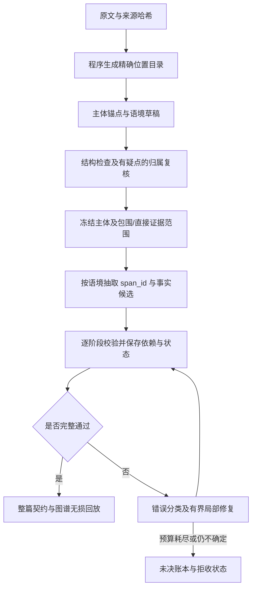

# 工程改进计划：从逐例补救转向受约束的抽取流水线

状态（2026-10-06）：验收目标为 Next Flash / Qwen3.8 27B；先用已配置的本地 Next Flash，27B未配置。v32–v34在同一篇已阅来源完成3次冻结版本实跑，共17次本地请求，均拒收且零调用回放一致，657项测试通过，0新云端调用。日期、Mention关联及属性分批已有工程实现；当前阻塞为匿名描述纠正后的所指对象与既有/新增Actor范围。下一项交付以末节“v34实测后的下一项交付”为准，不扩十篇。旧Max三篇0/3及单篇成功独立保留，累计百炼仍33.669768元。见 [目标模型报告](../research/next-flash-development-report.json)。

## 为什么需要改设计

现有校验器能发现问题，尚不能保证新文书稳定完成。v12/v13 在同一已曝光 Spark4396 原文上均为 0 整篇接受；v13 只完成头部和前两个子语境，第三个因提及文字与片段不匹配失败，其后六个未尝试。408 项测试证明已有边界检查可工作，不证明真实文书能完整抽取或法律语义正确。

| 实测问题 | 工程原因 | 要改的接口 |
| --- | --- | --- |
| 同一文字有 6 个合法来源位置，却生成了不含该文字的片段编号 | 文字、片段和 occurrence 分开生成，组合仍可无效 | 程序编译原文位置目录，模型引用 span_id |
| 已验证身份锚点再次生成导致重复 | 全量输出与增量合并责任不清 | 延续 v13 精确复用回执；规范 ID 与去重交给编译器 |
| 直接 court_finding 内仍有 2 条当事人报告用语提示 | 结构包含不等于陈述归属正确；冻结太早 | 在冻结前复核陈述者与来源，疑点未决不进入确定认定层 |
| 一个子语境失败，后续独立语境都没有检查 | 运行器按整篇 fail-fast，缺少可恢复的阶段依赖图 | 独立阶段继续诊断，失败阶段有界恢复，整篇发布仍严格把关 |
| 每轮只越过一个错误，缺少完整稳定性证据 | 回归以失败样例为中心，验收与调用成本未固定 | 冻结协议后完整回归固定 10 篇，明确扩样门槛 |

来源：[v12/v13 实测元数据](../research/qwen-scoped-context-report.json)、[历史试验反馈](experiment-feedback.md)。这是对接口和运行行为的工程诊断，不把两条归属提示当作已确证的法律错误。

## 目标流程

新增形式可以进入来源提议队列扩充目录；目录不能把尚未发现的提及静默排除。阶段暂存供诊断和恢复使用，未通过整篇验收的半篇不能发布为完整接受图。

## M1 · P0：原文位置编译器与有限引用接口

**首个交付物**：位置目录、生成 Schema 和编译适配器，先覆盖身份锚点及增量 Mention；再将相同接口用于日期、金额等有原文值的属性。

- 程序从真实原文生成 `span_id`、原始文字、起止位置、所在单元和来源哈希；模型输出 `span_id + actor_id + mention_kind`。这些字段按当前冻结范围生成约束，最终仍完整校验。
- 复用 `selector_repair.py` 已有精确 occurrence 枚举逻辑，适配 0.3 的直接断言范围，不能直接沿用旧协议的修复答案。保留 `scoped_incremental.py` 的精确复用回执。
- 初始目录可使用已定位的主体名称及原文形式；目录外形式必须有“来源提议 → 程序精确定位所有出现 → 目录扩展 → 有界选择”的路径。零命中、未知形式和不确定指代分别留账，不能当作没有提及。
- 6 次相同文字出现是 6 个不同位置，不强制只选一个；需要多次 Mention 时允许多选。某个旧错误提及如何对应这些位置仍需明确决定，不默认第一处、最近处或同名主体。
- 唯一字面匹配只证明坐标，不证明 Actor、类别或法律身份正确。规范名称不能代替本段实际代词/描述。属性的原文值与规范化值分开保存。

**验收**：不存在的 span、越界范围、错误来源哈希无法编译；重复文字、全角空格、Unicode 偏移、零命中和目录扩展有测试；保留实际失败的全部 6 个位置选项；不同主体/类别/位置不被合并；校验实际序列化的请求 Schema，避免再次出现字段共用配置而被误枚举的问题。真实原文回归材料只放忽略目录，Git 仅代码、元数据和非案件测试夹具。

## M2 · P0：语境冻结前的陈述归属复核

依赖 M1 的可核验来源接口，延续已有 0.3 包围范围/直接断言范围，不重写旧运行。

- 所有头部做确定性来源、嵌套和范围检查；出现报告用语、引用边界等疑点时，才进入来源受限的本地模型复核。
- 明确外层法院叙述、被转述的当事人主张、法院独立认定。复核只能显式保留、拆分、重新分类或标记不确定，保存原决定、新决定及对应证据；正则线索不自动改 kind。
- 一个原文单元混合多个陈述者时，使用保持原字节与偏移映射的更细跨度，或保留未决，不能为凑包含关系扩大直接认定范围。
- “法院采纳”必须有独立法院文字支持，不能凭章节标题或当事人引用推断。复核修改头部后，所有依赖阶段重新校验或失效。

**验收**：现有 2 条报告用语提示逐项得到来源支持的决定或显式未决；不能静默当作已解决。子引用不能提升为父语境认定，缺少依据不能被模型共识补成 gold。未决区域阻止整篇正式接受，但不妨碍其他独立区域的诊断执行。

## M3 · P1：阶段恢复与有预算的局部修复

顺序恢复已实现：复用哈希验证且请求/Schema一致的前缀响应，所有本地检查重新执行，指定重启点后全部重生成；实跑已复用38次响应。以下独立分支隔离仍待完成。`scoped.py` 仍按依赖顺序 fail-fast，不能仅删除 raise 就宣称阶段独立。

- 冻结全局主体目录；每个语境保存局部 Mention/事实增量，显式声明引用依赖，经合并校验后提交阶段产物。失败阶段的未验证提及不能被后续阶段使用。
- 保存来源、头部、目录、协议、提示、Schema、模型配置和依赖哈希。恢复只能复用仍有效的已验证阶段；依赖变化后只使受影响的下游失效。新首轮基准禁止复用旧运行产物。
- 内容错误隔离到阶段，独立语境继续诊断；依赖失败则记录 blocked。服务繁忙或传输故障停止新请求，保持现有互斥锁和负载检查，不操作模型服务。
- 按错误类型分流：ID/已知精确重复由编译器处理；定位问题进入有限目录选择；归属问题进入局部来源复核；截断缩小阶段后另记重试；不把所有失败送回全篇重抽。
- 已实现的发现纠正预算为每阶段至多1次、每篇至多3次纠正；同一费用谱系内同篇至多3次显式续跑，重选较早来源不重置计数。续跑的依赖后缀可能需要多次新请求，所有新调用完整计费，不称作只有一次纠正。新增语义复核/改写尚未自动运行，接入前须登记单独的篇级调用预算。预算耗尽仍未解决则保留拒收。

**验收**：中断重启不重复调用有效阶段；失败阶段不污染后续；依赖篡改使缓存失效；完整离线回放一致；原草稿、失败和修复次数不可变；半篇不可发布为整篇接受。上述预算是下一轮初始工程约束，不是实测最优值。

## M4 · 验收回归与扩样门槛

1. 把已有失败响应转为私有离线回归包，覆盖定位、重复、父子范围、转述归属、跨语境属性和截断。先完成 M1–M3 的离线验证。
2. 在本地 Qwen 从原文重新跑 Spark4396、AppealCase026b、442c 三个已知困难来源，记录每个阶段的通过/失败/阻塞/未尝试及原因。必须检查完整流水线，不能只报前两个阶段通过。
3. 小样排除已知系统性故障后，预登记并冻结新协议、代码、Schema、模型配置和预算，在原固定 10 篇做完整新首轮；温度 0.2、seed42、串行，记录实际服务模型版本。推理输入不含 QA、旧候选或修复答案，完整 36 篇清单继续记录未选中项。
4. 分开报告：原始阶段输出通过率、整篇无纠正首轮通过率、有界修复后通过率、未决/拒收、全部请求数与 tokens、请求耗时及墙钟时间、未覆盖原文范围、目录外提议和拒绝断言。归属复核只要改写了原头部，就计入修复结果，不能包装成无纠正首轮。无修改的复核也计请求成本。
5. 验证接受图的原文证据、保存还原及导出保真；对比各语境/事实类型产出、未决和拒绝账本，防止少抽内容换表面通过。没有独立参考时只能诊断覆盖变化，不能宣称语义 recall。

**下一轮预登记的初始扩样门槛**：固定 10 篇无纠正首轮至少 8 篇通过；有界修复后至少 9 篇通过；10 篇均有完整状态和零调用回放；接受候选中 0 项已知硬约束违规；已知归属疑点全部有显式决定或未决记录，不能冒充已验证认定；调用不超过登记预算。8/10、9/10 是工程目标，不是当前成绩或统计充分性证明。门槛不能在看到结果后下调以宣布达标。

若未达标，按错误分布修改对应机制再完整回归；达标后才登记下 10 篇并核验关联案组，从 10 推进到 20/36。仍是开发扩展，不称独立盲测。新旧协议的契约/调用结构不同，历史 v8 3/10 只能作历史背景；若宣称某项设计带来提升，须在相同来源、契约和配置下做有/无该设计的成对对照，并报告额外调用成本。

## 当前下一步与停止条件

1. **日期候选覆盖**：识别原文中有效的点分日期及尾随“号”等格式，保留原字/偏移；用合成边界测试覆盖非法日期，不能为通过校验改选其他日期。
2. **提及选择接口**：每个称谓只允许其真实位置列表；减少模型同时维护“提及”和“提议决策”两份关联表，由同一选择编译两者。原始未决仍保留，不能删除缺项或强绑主体。
3. **属性阶段负荷**：去除完全重复Schema，使用共享定义；按事件所有者分批，保存所有事件处理清单和完整合并校验。此次134850的值是UTF-8字节加预留量，不是实测tokens，也不是百炼拒绝上下文。
4. 上述修复加私有失败回归后，冻结新提交，从原文重新完整运行同三篇；当前0/3保持，不把修复续跑混进新首轮。不进行盲目重试或下调约束来扩大成功数。
5. 三篇达到稳定工程通过并明确处理来源/归属疑点后，再进入固定十篇；已有8/10无追加纠正、9/10有界修复目标不降低。独立来源归属/支持性审查仍是语义验证前提，模型一致性不当gold。

### 工作项状态

| 顺序 | 交付 | 状态 | 完成后才做 |
| --- | --- | --- | --- |
| M1 | 原文位置目录、span_id 生成接口、严格编译及回归 | 主体与未具名补充、证据/事件/属性分阶段已实现；v31同篇全新自动运行11语境及回放/装配通过；语义诊断待处理 | M2 来源归属复核 |
| M2 | 冻结前复核、细粒度范围与未决账本 | 待实施 | M3 阶段依赖恢复 |
| M3 | 可恢复阶段、错误分流及篇级修复预算 | 发现阶段有界纠正及顺序前缀恢复已实现；独立分支隔离未完成 | M4 三篇完整试跑 |
| M4 | 目标模型单篇、三篇困难回归、固定十篇验收 | Max三篇0/3；本地Next Flash同一篇v32–v34均拒收并完成回放，三篇/十篇暂缓 | 达到登记门槛后扩样 |

M1已有代码及边界回归，M3已有顺序恢复与真实复用；M2独立语义复核、M3独立分支和M4仍未完成。不能把版本迭代或历史修复快照记为整套架构验收。

最新授权改为既有百炼北京项目优先，本轮累计支出上限 200 元；预算沿用所有已执行版本账本，不重新归零。本地适配保持，不修改 Spark 服务，OpenJev 仍仅作有限影子对照；不执行已取消的 8K/16K 测速。默认 v5 保持，升级在独立版本完成验证后另行记录。用户无法提供专业 gold，不以其法律补标阻塞工程开发；整体语义 P/R/F1 保持 null。原文、QA、模型响应和图谱只在忽略目录及已授权 Google 项目文件夹，GitHub 仅代码、文档与元数据。

最新试验反馈：v14位置选择能保持来源，却无法关联头部漏掉的组织主体。下一项应在冻结前加入来源受限的新Actor提议及有界补全，并独立检查地址形锚点；不能只降低温度、删除未决或放宽编译约束。完整结果见[跨度首轮](../research/qwen-span-v14-report.json)。

最新v15/v16反馈：全文位置目录需使用可回溯短编号控制输入膨胀；主体发现前移已运行，但云端同样会规范化空格。增加零命中提议到原文空白变体候选的显式步骤，保留原提议与原文字节，不把宽松匹配当自动身份结论。v16云端出现未决后按约定停止，2次估算0.210684元、0/1整篇接受，不能称架构已验收。

## 2026-10-06：目标模型与 v32 冻结试跑

用户明确最终目标为 Next Flash 或 Qwen3.8 27B。此前 v31 云端结果使用 Qwen3.8-Max-0902，只作为故障诊断参考，不能代替目标模型验收。已只读核实已有 Spark LAN 8003 服务为 `qwen3.8-flash-next-iq4xs`，实际配置 32768 上下文；27B 尚未配置/核实，不擅自部署或假定兼容。本轮先用已有本地 Next Flash，无新增云端费用。

v32 增加实际日历校验的点分/斜线/连字符日期字面候选，原字与位置不变；提议逐项 select/uncertain，选中位置从唯一 Mention 表与各自冻结候选的交集编译，不能借用其他提议的位置；属性分为主体批次及每事件一批，全部事件处理后严格合并，失败整篇拒收。旧版本行为保留。442c 私有失败的 9 事件 Schema 离线分批后最大 12916 字节，原为 50644 字节；这只是输入结构验证，不是新推理通过。

预登记见 `research/next-flash-v32-preregistration.json`。首先在冻结代码上从原文运行 Spark4396，0 旧响应复用，记录所有请求/实际 tokens/耗时/纠正及未尝试范围，自动零调用回放，接受后自动装配。此步骤未通过不自动扩三篇；通过后再冻结同三篇目标模型回归，三篇门槛与固定十篇目标不降低。独立归属/支持性审查仍待实现，不把工程通过当语义正确。

### v32 目标模型反馈与 v33

Next Flash v32 从干净6cfc257运行，2次实际请求共81.520秒，主体选择发现4个法律/规定标题不属于Actor，原流程无显式非主体类型出口，整篇拒收；0/1、35未选中，失败及零调用回放/冻结校验已保存，不产生图。详细记录research/next-flash-v32-report.json。

v33在主体冻结前增加来源受限的候选类型步骤，每批至多8项，明确actor_candidate、legal_instrument_title或uncertain；每项必须选择自己的真实位置。法律标题排除保留原提议、位置、类型判断、旧新索引映射及完整账本；不匹配、无法判断或全部排除仍拒收，不把分类当已验证法律语义。法院名称即使出现在法条引用中仍可保留为主体；不泛化为自动删除机构或其他类别。这是预先设计的流程步骤，不是图中手工删除。新试验从原文开始、不读取v32响应，失败不自动扩样。

### v33 反馈与 v34

v33在7490e3b上完成7次Next Flash请求：21项类型检查保留17个主体候选、显式排除4个法律标题、无类型未决，具名主体目录通过；随后未具名描述中1项拼接词语没有连续原文位置，仍0/1、35未选中，零调用回放及冻结校验通过，无新图。652项测试通过，报告research/next-flash-v33-report.json。

v34将正文已有的来源校验/有限片段纠正复用于具名和未具名发现，所有发现阶段共用每篇最多3次、每阶段最多1次纠正预算；完整保留原提议/实际片段选项/模型修正/失败，不删无法匹配提议。另将属性ID按阶段及所有者由程序编译并保存可逆映射，防止独立批次重用s1之类编号；同一批次重复ID仍拒收。这些是冻结前的自动处理，成功后才允许装配，不修改图谱来换通过。新试验从原文重新运行，不复用v33响应。

### v34 实测后的下一项交付

v34在干净06b7e98上完成8次请求、164.958秒，其中1次预定的自动发现纠正。纠正后4个片段都有真实位置，但一个片段被指向本批新匿名主体目录外的既有Actor，严格校验拒收。完整失败、纠正、原文跨度和零调用回放保留。当前只有具名主体目录及来源检查的局部验证，语境/事件/属性/图装配尚未执行；不能把单元测试或Schema缩小记为目标模型端到端成功。657项测试通过。

下一项改动要从指代对象而非字符串切割出发：发现描述只是检索提议，程序枚举实际完整称谓候选；模型明确选择既有主体、新匿名主体或不确定。已存在主体只允许从冻结目录选择，新主体必须在本批创建且可回溯；不确定保留拒收。原“原告某某的…”这类所有格片段不能仅因字面存在就视作未具名个体。不能直接把任意既有Actor ID加进匿名编译器来换通过，也不能静默删除不匹配项。新接口须覆盖关系描述、多个同称谓个体、部分短语与既有姓名混入，再冻结版本从原文验收；不继续盲目重抽或扩大十篇。

汇总research/next-flash-development-report.json：同一篇3个协议版本、17次本地请求、请求耗时398.743秒、0整篇接受、35篇未选中、3轮回放一致、0新云端费用。旧Max指标独立保存。

### v35：所指对象与身份目录接口

针对v34失败，未具名描述不再用任意最大公共子串拼出多个新提议。自动纠正只允许同轮已发现且有原文位置的完整称谓候选，由模型判断是否保持所指个体；没有候选仍拒收。这是来源支持，不是完整短语或身份等价的语义证明。随后每个提议独立从自己的位置目录选择，并明确existing（冻结Actor枚举）、new（预分配实体槽位）或uncertain。程序按槽位编译主体及Mention，已有主体仅可追加有证据的提及，ID、类型及原有Mention不可变。未知ID、漏项、跨提议位置、槽位类型冲突、未决仍整篇拒收。所有原提议、选择、来源和映射保留。

新版本为v35，预登记research/next-flash-v35-preregistration.json；仍使用本地Next Flash 32K、温度0.2、seed42，从完整36篇清单选择同一篇Spark4396新运行，不复用任何旧响应。全流程通过后才装配；既有/新增的语义归属仍需独立验证，不将工程通过称为法律正确。

### v35 实测反馈与 v36 集合指代

v35 在 ddd9935 上完成8次 Next Flash 请求，其中1次自动来源纠正；已知/新主体接口能处理单个指代，但一处原文并列指向两名已知主体，接口只能选择一个，模型保留 uncertain，整篇拒收。失败0/1及35篇未选中、冻结检查和零调用回放均保留，未生成图。

v36 增加 existing_group 分支：至少两个不同的冻结 Actor ID，选择本提议自己的唯一位置，分别生成或复用各主体 Mention；不创建合并主体，不静默只选一个成员。单成员、重复/未知成员、跨提议位置仍拒收；成员关系是模型判断，来源跨度通过不证明语义正确。旧v35默认行为不变。新代码冻结后从同一原文完整重跑，前轮输出不得作为新运行输入。
