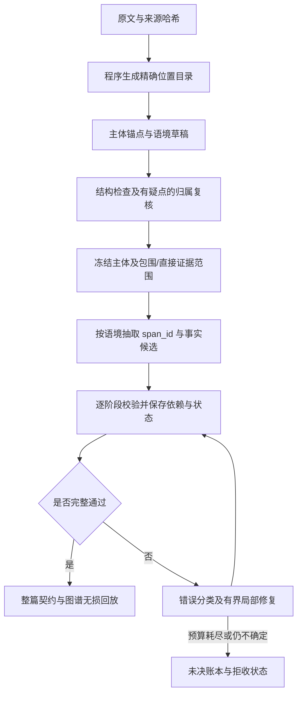

# 工程改进计划：从逐例补救转向受约束的抽取流水线

状态：M1位置目录/Schema/编译基础模块已实现，见 [跨度目录](span-catalog.md)；v14生成器接线和真实单篇首轮已完成，因冻结Actor缺项0/1接受；M2–M4主流程待实施；用户新增授权在独立分支先做 [Qwen/OpenJev 影子评测](jev-shadow-evaluation.md)，不将其等同于 M2 完成。核对基线：`1ecca32`，408 项测试；本计划没有产生新模型结果。本文是当前实施顺序的唯一入口，roadmap、交接和 Google 项目文档指向本文；历史试验中的“下一步”仅保留为当时记录。

## 为什么需要改设计

现有校验器能发现问题，尚不能保证生成流程稳定完成。v12/v13 在同一已曝光 Spark4396 原文上均为 0 整篇接受；v13 只完成头部和前两个子语境，第三个因提及文字与片段不匹配失败，其后六个未尝试。408 项测试证明已有边界检查可工作，不证明真实文书能完整抽取或法律语义正确。

| 实测问题 | 工程原因 | 要改的接口 |
| --- | --- | --- |
| 同一文字有 6 个合法来源位置，却生成了不含该文字的片段编号 | 文字、片段和 occurrence 分开生成，组合仍可无效 | 程序编译原文位置目录，模型引用 span_id |
| 已验证身份锚点再次生成导致重复 | 全量输出与增量合并责任不清 | 延续 v13 精确复用回执；规范 ID 与去重交给编译器 |
| 直接 court_finding 内仍有 2 条当事人报告用语提示 | 结构包含不等于陈述归属正确；冻结太早 | 在冻结前复核陈述者与来源，疑点未决不进入确定认定层 |
| 一个子语境失败，后续独立语境都没有检查 | 运行器按整篇 fail-fast，缺少可恢复的阶段依赖图 | 独立阶段继续诊断，失败阶段有界恢复，整篇发布仍严格把关 |
| 每轮只越过一个错误，缺少完整稳定性证据 | 回归以失败样例为中心，验收与调用成本未固定 | 冻结协议后完整回归固定 10 篇，明确扩样门槛 |

来源：[v12/v13 实测元数据](../research/qwen-scoped-context-report.json)、[历史试验反馈](experiment-feedback.md)。这是对接口和运行行为的工程诊断，不把两条归属提示当作已确证的法律错误。

## 目标流程

新增形式可以进入来源提议队列扩充目录；目录不能把尚未发现的提及静默排除。阶段暂存供诊断和恢复使用，未通过整篇验收的半篇不能发布为完整接受图。

## M1 · P0：原文位置编译器与有限引用接口

**首个交付物**：位置目录、生成 Schema 和编译适配器，先覆盖身份锚点及增量 Mention；再将相同接口用于日期、金额等有原文值的属性。

- 程序从真实原文生成 `span_id`、原始文字、起止位置、所在单元和来源哈希；模型输出 `span_id + actor_id + mention_kind`。这些字段按当前冻结范围生成约束，最终仍完整校验。
- 复用 `selector_repair.py` 已有精确 occurrence 枚举逻辑，适配 0.3 的直接断言范围，不能直接沿用旧协议的修复答案。保留 `scoped_incremental.py` 的精确复用回执。
- 初始目录可使用已定位的主体名称及原文形式；目录外形式必须有“来源提议 → 程序精确定位所有出现 → 目录扩展 → 有界选择”的路径。零命中、未知形式和不确定指代分别留账，不能当作没有提及。
- 6 次相同文字出现是 6 个不同位置，不强制只选一个；需要多次 Mention 时允许多选。某个旧错误提及如何对应这些位置仍需明确决定，不默认第一处、最近处或同名主体。
- 唯一字面匹配只证明坐标，不证明 Actor、类别或法律身份正确。规范名称不能代替本段实际代词/描述。属性的原文值与规范化值分开保存。

**验收**：不存在的 span、越界范围、错误来源哈希无法编译；重复文字、全角空格、Unicode 偏移、零命中和目录扩展有测试；保留实际失败的全部 6 个位置选项；不同主体/类别/位置不被合并；校验实际序列化的请求 Schema，避免再次出现字段共用配置而被误枚举的问题。真实原文回归材料只放忽略目录，Git 仅代码、元数据和非案件测试夹具。

## M2 · P0：语境冻结前的陈述归属复核

依赖 M1 的可核验来源接口，延续已有 0.3 包围范围/直接断言范围，不重写旧运行。

- 所有头部做确定性来源、嵌套和范围检查；出现报告用语、引用边界等疑点时，才进入来源受限的本地模型复核。
- 明确外层法院叙述、被转述的当事人主张、法院独立认定。复核只能显式保留、拆分、重新分类或标记不确定，保存原决定、新决定及对应证据；正则线索不自动改 kind。
- 一个原文单元混合多个陈述者时，使用保持原字节与偏移映射的更细跨度，或保留未决，不能为凑包含关系扩大直接认定范围。
- “法院采纳”必须有独立法院文字支持，不能凭章节标题或当事人引用推断。复核修改头部后，所有依赖阶段重新校验或失效。

**验收**：现有 2 条报告用语提示逐项得到来源支持的决定或显式未决；不能静默当作已解决。子引用不能提升为父语境认定，缺少依据不能被模型共识补成 gold。未决区域阻止整篇正式接受，但不妨碍其他独立区域的诊断执行。

## M3 · P1：阶段恢复与有预算的局部修复

依赖 M1/M2 的稳定头部和目录。现有 `scoped.py` 在子阶段异常时直接中止；不能仅删除 raise 就宣称阶段独立。

- 冻结全局主体目录；每个语境保存局部 Mention/事实增量，显式声明引用依赖，经合并校验后提交阶段产物。失败阶段的未验证提及不能被后续阶段使用。
- 保存来源、头部、目录、协议、提示、Schema、模型配置和依赖哈希。恢复只能复用仍有效的已验证阶段；依赖变化后只使受影响的下游失效。新首轮基准禁止复用旧运行产物。
- 内容错误隔离到阶段，独立语境继续诊断；依赖失败则记录 blocked。服务繁忙或传输故障停止新请求，保持现有互斥锁和负载检查，不操作模型服务。
- 按错误类型分流：ID/已知精确重复由编译器处理；定位问题进入有限目录选择；归属问题进入局部来源复核；截断缩小阶段后另记重试；不把所有失败送回全篇重抽。
- 初始预算为每阶段至多 1 次模型纠正、每篇至多 3 次额外模型调用；阶段拆分后也共享篇级预算，避免递归重试绕过上限。归属改写、目录扩展选择、截断重试均计入。预算耗尽仍未解决则保留拒收。

**验收**：中断重启不重复调用有效阶段；失败阶段不污染后续；依赖篡改使缓存失效；完整离线回放一致；原草稿、失败和修复次数不可变；半篇不可发布为整篇接受。上述预算是下一轮初始工程约束，不是实测最优值。

## M4 · 验收回归与扩样门槛

1. 把已有失败响应转为私有离线回归包，覆盖定位、重复、父子范围、转述归属、跨语境属性和截断。先完成 M1–M3 的离线验证。
2. 在本地 Qwen 从原文重新跑 Spark4396、AppealCase026b、442c 三个已知困难来源，记录每个阶段的通过/失败/阻塞/未尝试及原因。必须检查完整流水线，不能只报前两个阶段通过。
3. 小样排除已知系统性故障后，预登记并冻结新协议、代码、Schema、模型配置和预算，在原固定 10 篇做完整新首轮；温度 0.2、seed42、串行，记录实际服务模型版本。推理输入不含 QA、旧候选或修复答案，完整 36 篇清单继续记录未选中项。
4. 分开报告：原始阶段输出通过率、整篇无纠正首轮通过率、有界修复后通过率、未决/拒收、全部请求数与 tokens、请求耗时及墙钟时间、未覆盖原文范围、目录外提议和拒绝断言。归属复核只要改写了原头部，就计入修复结果，不能包装成无纠正首轮。无修改的复核也计请求成本。
5. 验证接受图的原文证据、保存还原及导出保真；对比各语境/事实类型产出、未决和拒绝账本，防止少抽内容换表面通过。没有独立参考时只能诊断覆盖变化，不能宣称语义 recall。

**下一轮预登记的初始扩样门槛**：固定 10 篇无纠正首轮至少 8 篇通过；有界修复后至少 9 篇通过；10 篇均有完整状态和零调用回放；接受候选中 0 项已知硬约束违规；已知归属疑点全部有显式决定或未决记录，不能冒充已验证认定；调用不超过登记预算。8/10、9/10 是工程目标，不是当前成绩或统计充分性证明。门槛不能在看到结果后下调以宣布达标。

若未达标，按错误分布修改对应机制再完整回归；达标后才登记下 10 篇并核验关联案组，从 10 推进到 20/36。仍是开发扩展，不称独立盲测。新旧协议的契约/调用结构不同，历史 v8 3/10 只能作历史背景；若宣称某项设计带来提升，须在相同来源、契约和配置下做有/无该设计的成对对照，并报告额外调用成本。

## 执行顺序与停止条件

| 顺序 | 交付 | 状态 | 完成后才做 |
| --- | --- | --- | --- |
| M1 | 原文位置目录、span_id 生成接口、严格编译及回归 | 目录/接线/真实首轮完成；冻结Actor缺项阻塞整篇，属性值待做 | M2 来源归属复核 |
| M2 | 冻结前复核、细粒度范围与未决账本 | 待实施 | M3 阶段依赖恢复 |
| M3 | 可恢复阶段、错误分流及篇级修复预算 | 待实施 | M4 三篇完整试跑 |
| M4 | 三篇困难回归、固定十篇验收、完整报告 | 待实施 | 达到登记门槛后扩样 |

本轮只制定并同步计划，不把文档、旧 408 项测试或历史修复快照记为 M1–M4 已完成。首个可审查成果是 M1 的代码、实际请求 Schema 和离线边界回归，随后按顺序推进。

只使用既有本地模型服务；无新付费 API，不修改 Spark 服务，OpenJev 仅在已授权独立分支做有限影子对照；不执行已取消的 8K/16K 测速。默认 v5 保持，升级在独立版本完成验证后另行记录。用户无法提供专业 gold，不以其法律补标阻塞工程开发；整体语义 P/R/F1 保持 null。原文、QA、模型响应和图谱只在忽略目录及已授权 Google 项目文件夹，GitHub 仅代码、文档与元数据。

最新试验反馈：v14位置选择能保持来源，却无法关联头部漏掉的组织主体。下一项应在冻结前加入来源受限的新Actor提议及有界补全，并独立检查地址形锚点；不能只降低温度、删除未决或放宽编译约束。完整结果见[跨度首轮](../research/qwen-span-v14-report.json)。
