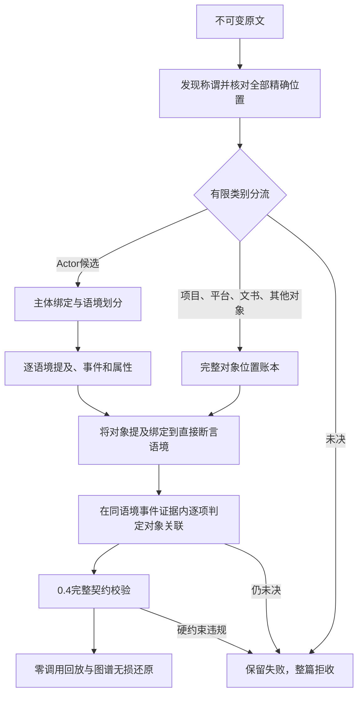

# v38：主体与具体对象分流

项目、平台本身不是 person/organization/court。既有 v37 把这些有效提议送往 Actor 绑定，正确拒判仍导致整篇失败。v38 在具名、未具名和正文形式经过原文检查后，统一分流 Actor、带证据具体对象、未决；不删除原提议，也不推断平台运营者。

契约 0.4 在 0.3 语境隔离基础上增加 Object、ObjectMention、ObjectLink。对象类别为 project/platform/instrument/other；每个对象有精确来源提及，每个提及属于唯一直接断言语境。只有同一原文位置且类型一致才复用对象；同名不自动合并，冲突拒收。Actor 仍独立承担陈述者、诉讼角色与事件参与者。

分流使用中文有限类别定义、程序给出的逐字位置和相邻原文。模型须确认一个提议列出的所有位置均属同一类别及所指，否则保留未决。每批最多 8 项，原始响应、原提议、全部位置及路由账本保留。此处仍是模型判断，不是独立语义验证。

完成原有语境和事件抽取后，逐语境建立对象—事件候选。候选必须在同语境且对象提及位于事件证据内；模型另判 linked / no_supported_event / uncertain。共现不自动建边，无充分关联的对象保留为未关联对象；未决拒收。ObjectLink 显式继承事件 polarity，保留对象提及证据，不能改变当事人主张为法院事实。

最终记录经过完整契约校验，图投影保留新集合、全部证据及引用顺序，可无损反向还原。旧契约及旧协议保持兼容。这里没有将 Jev 加入主流程：此前 Qwen 与 Jev 都能完成有限分类，先验证结构修复本身的效果，再评估额外模型是否有净收益。

## 实际阶段连接

对象分流并不替代共指、陈述归属和事件属性检查。对象出现但没有足够事件关联依据时，保留对象与提及、不生成关联边；这类未关联记录单独计数，不能当作完整关系召回。

## 冻结验证

新增 24 项元数据边界/整流程模拟测试，不是案件 gold。真实测试登记于 research/next-flash-two-v38-preregistration.json：完整 36 篇输入中固定两篇历史失败文书，34 篇未选，先 442c 后 026b；本地 Next Flash、温度 0.2、seed 42、32K。每篇一次新调用流程、不读旧响应、不手改图，预设流程内纠正另计。成功必须整篇接受、零调用回放、冻结输入不变、图谱无损还原。失败保留，改代码后必须新版本或新冻结运行，不能覆盖失败。

真实结果尚待运行；通过也不代表整体语义 P/R/F1。身份、角色方向、法律语境判别和检索收益仍需后续独立验证，不依赖用户补法律 gold。暂不扩大十篇。

首个冻结运行（代码 7ed8451）两篇均因分流请求重复完整证据元数据而超限，3 次本地调用、0/2 接受，失败与回放保留于 research/next-flash-two-v38-01-report.json。紧凑修复只向模型发送 unit_id/start/end，完整哈希与原字仍留账本；相同历史形式的六批分词探针均可容纳于 32K（非新抽取）。第二轮独立登记 next-flash-two-v38-02，不覆盖首轮。

第二批 e39e213 完成 102 次本地调用后仍 0/2：442c在第8语境出现多个具体主体绑定与同称谓总未决矛盾；026b在第4语境把“其”的多个用法合并为类型未决。两篇均零调用回放及冻结验证通过。对象通道解决了平台进入Actor的问题，但形式级判定仍混淆不同出现；下一版必须保留逐位置决定，不能直接覆盖未决。详见 research/next-flash-two-v38-02-report.json。
