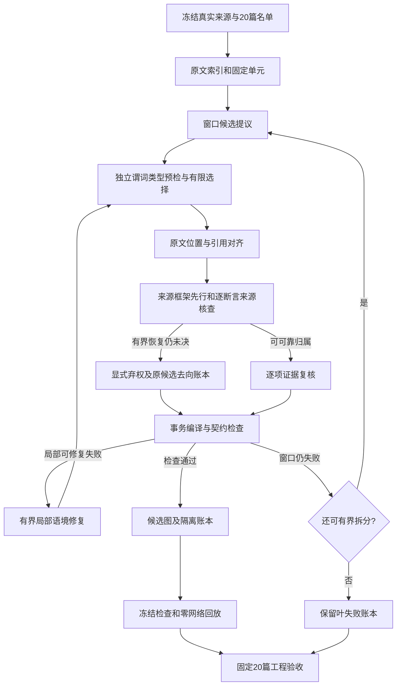

# 固定20篇持续修复：工程经验

目标是一次冻结实现从原文自动完成流程，不依赖人工改图、旧响应拼接或替换失败文书。工程验收见 [twenty-acceptance.md](twenty-acceptance.md)。第一轮16/20工程通过；第二轮独立冻结新运行20/20工程通过及零网络回放。两轮未拼接，语义完整性与检索收益仍未验证。

## 失败如何进入设计

| 观察到的问题 | 实施的改动 | 仍然保留的边界 |
| --- | --- | --- |
| 一项复核格式错误使整窗有效候选丢失 | 逐项核验、只反馈错误项、保存协议错误审计 | 未恢复的协议错误阻止工程通过，不能当作普通语义未决隐藏 |
| 主张归属误绑到当事人，或法院认定的说话者被设成人名 | 用背景引导句确认当事人持续说话者；法院说话者类型检查；只修复失败语境 | 无依据时保留unknown和未决，不猜归属 |
| 全窗重生成反复改坏已正确内容 | 对失败语境局部重生成，保留语境原文单元集合及其他语境 | 修复后必须重新对齐、复核和编译，不直接改图 |
| 没有约定利息或日期，被配成数值/日期谓词 | 独立预检所有陈述的谓词和值类型；模型在兼容谓词集合中有限选择 | 不改原值、极性、主体及证据；other表示本体或类型表达缺口，unresolved保留未决 |
| 集合或主体依赖失败遮住后续陈述类型错误 | 谓词预检提前到依赖装配前 | 编译仍检查最终契约，预检不替代原文语义核验 |
| 双方、二被告、合议庭等被降级成unknown actor | 明确复数称谓的主体/集合冲突保护；集合成员未知、部分和明确分别记录 | 规则只覆盖明确称谓反例，不能证明所有集合语义分类正确 |
| 事件对象有证据，但复核没有带入对象位置 | supported事件的证据须包含对象提及单元；陈述须包含值的原文单元 | 不支持关系时隔离该候选与依赖，不能只靠共现入图 |
| 局部字段修好后产生重复节点或残留错误项 | 事务编译，失败时回滚候选及来源映射，再进行有界反馈 | 不保留失败事务的图项；原稿和错误记录独立留档 |
| 模型反复违约导致无限重试风险 | 每窗协议/契约修复有上限；最多两层拆分16→8→4 | 父失败保留，子窗必须精确覆盖；叶失败仍计失败 |
| HTTP 200、合法JSON、可回放被误当作完整抽取成功 | 分开报告传输、工程通过、离线回放、未决及语义完整性 | 全部原文单元被记账不是语义召回；没有专家gold就不报告语义P/R/F1 |

## 当前顺序

自动修复是预先限定的工作流程的一部分。它不同于无修复首轮，也不同于历史失败响应的诊断回放。三者不能拼接或互换分母。

## 达成工程通过之后

先报告隔离和other谓词的数量、跨语境主体重复及原文覆盖限制，再用独立的新问题对照文本检索与图扩展。图层是否值得保留，由证据命中、引用正确性、额外成本和实际增益决定。20篇工程通过本身不证明类案检索或GraphRAG收益。

## 来源语义轮次的经验（2026-10-07）

工程协议能通过之后，来源回读仍发现主张被放入法院框架、借贷性质否定被误配到转账存在性、利息期间被配成还款期限等问题。新版的框架先行复核和逐断言来源核查已实现，但同模型仍有漏判：source-semantic-05第8语境保留了法院转述的“欲证明”还款。这项结构接收必须视为质量风险，不能作为正确样本扩大测试。

为该反例加入独立的原文目的性表述风险检查；触发后只允许重新归属或明确未决，模型supported不能绕过。source-semantic-07将该语境整体弃权，原候选和全部调用保留。这是阻止已知错误进入图，尚未实现保留正确部分的可靠重抽。框架弃权、断言隔离和非空保留分别计数，不能统一报成“修复成功”。

复核协议错误也需要分层处理。模型支持目标段落，却只引用背景的回答不满足支持条件；有界重试仍失败时，无效题目被程序明确设为uncertain，其他合法回答保留，原响应和规则适配账本留存。该适配不是模型核验成功。证据必选位置不在允许语境内时，在调用前识别无解约束，不扩大范围迁就模型。

可靠性改动增加调用及等待。649fa7a的fresh-02第一篇68个单元用了74次调用、约1236秒；输入token P50为5042、P95为8831、最大9380，一次输出仍达到8192上限。这个记录只描述该文书，不外推所有文书的耗时、上下文或质量收益。后续要根据真实调用账本减少重复恢复与低风险题目的复核，而不能靠放宽引文或静默弃掉困难原文提速。

来源本身也可能不一致。本轮发现同一文书同时有匿名称谓和不同字面姓名；自动主体合并必须要求明确的身份联系，不能替原文补写解释。已经从原文登记6个开发问题及精确引用，尚未评分；它们是来源直接表述的核对参考，不是盲测或专家图谱gold。

工程目标见 [项目定位](project-positioning.md)：先给出可回读原文的关系与分歧，再评估是否改善同案查询。没有图净增益则保留可靠文本能力；不把fixed20工程通过包装为通用自主Agent、完整法律语义质量或GraphRAG领先结果。
