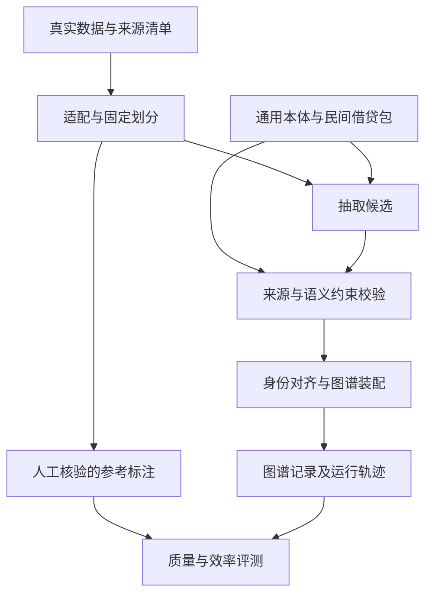

# P0 系统架构

状态：设计，尚未实现。完整协议见 [P0 计划](p0-plan-v0.2.md)。

目标：把经核验的真实案件文书转换为有本体类型、语境和原文来源的图谱记录，并测量从输入到最终构图的质量与成本。

| 模块 | 职责 | 交付与边界 |
|---|---|---|
| 数据适配 | 原文读取、段落定位、来源映射、分组划分 | 不改写事实；原文与处理版本分开 |
| 本体与领域包 | 核心概念、案由扩展、关系、定义及约束 | 定义由开发集支持；未知类型保留，不强塞分类 |
| 模型适配 | Qwen 抽取；可选 OpenJev 候选判断 | 统一运行日志、超时、重试与参数记录 |
| 校验 | 结构合法、引用定位、允许类型及关系端点 | 通过校验不意味着语义正确；保留被拒记录与原因 |
| 图谱装配 | 案件内身份映射、节点关系、语境主张、来源 | 不因同名跨案合并；装配前后记录可对账 |
| 评测 | 一对一匹配、TP/FP/FN、分桶统计及耗时 | 标注范围外输出单列；失败文书不得静默删除 |

图谱使用存储无关的节点、边、事件、主张和来源记录。JSONL 等序列化方式在 #16 契约设计中确定；当前不强制 Neo4j、PostgreSQL 或向量库。数据库适配须证明导入前后语义记录一致。

## 语义边界

核心候选概念为 Case、Actor、Mention、Participation、Event、Assertion、EvidenceSpan。这里是建模候选，正式类型集由 #16 结合实际数据确认。

主张至少区分陈述者、内容、否定、来源性质、案件范围、时间和证据定位。法院转述当事人陈述不能自动转换为法院认定；文书中的证据描述不能冒充原始证据。

案由差异进入领域包；文书类型进入解析配置。模型接口、来源定位、任务运行与评测框架保持通用。第二案由仅保留扩展边界，当前不实现完整功能。

## 可复现运行

每次运行固定数据与划分、本体、gold、提示、模型服务标识、参数和代码版本。保存原始模型输出、候选、校验结果、最终图谱、失败及重试日志。缓存键包含所有影响语义输出的版本。

先建立 Qwen 基线，再比较本体约束、校验装配和 OpenJev 辅助。未完成相同输入与评测协议下的对照，不作质量或速度增益结论。

当前实现顺序与验收以 GitHub #14–24 为准，不以此图中的方框数量估算已完成比例。
