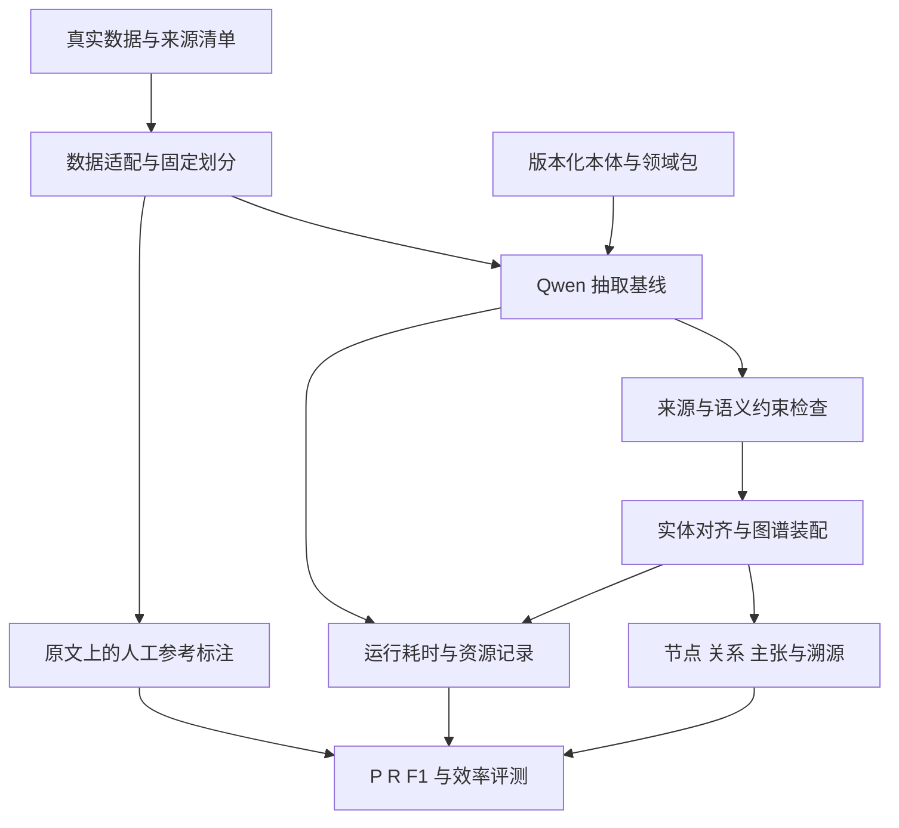

# 案件文书本体与图谱构建开发计划

设计版本：v0.2。修订时间：2026年10月3日，Australia/Sydney。状态：任务规划已形成，P0实施尚未开始。本版取代v0.1中的首版范围与人工构造案例计划。

首阶段只建设真实案件文本到本体约束图谱的处理与评测流程。核心目标是图谱构建的precision、recall、F1及效率。民间借贷为首个目标领域，最终可评估范围由真实数据及标注覆盖决定。类案检索、知识问答、前端产品和第二案由列入后期。

## 本轮范围与交付

P0交付六项内容：可追溯的真实数据清单；冻结的本体与图谱契约；真实原文上的参考标注；可重跑的抽取及构图管线；分层precision/recall/F1评测器；质量与效率基线和消融报告。

原文来自核验通过的真实数据集。不得自行编写案件、改写人物金额日期、拼接多案形成新案，或将模型生成材料混入开发测试语料。此前会话使用的虚构付款争议只属于历史接口连通检查，不进入任何P0数据清单或质量结果。

本轮不要求API、业务界面、在线检索或复杂后台服务。优先CLI与批处理脚本，先完成可复现的本体和图谱实验，再决定产品工程投入。既有仓库用于任务跟踪；旧系统代码、旧数据和旧成绩不作为本轮兼容要求或质量证据。

## 真实数据与困难样本规则

原先“手工构造12个边界场景”改为“从真实数据集中筛选困难样本”。12只是首批审阅规模参考：数据实际不足时保留缺口，不为了凑数量制造样例。

每个样本登记dataset_id、dataset_version或commit、source_id、下载文件哈希、原文哈希、文本范围及许可信息。数据适配器可以清洗编码、分段和规范化格式，但必须保留原文与位置映射，不改变法律事实、语义和否定表达。

允许在真实原文上补充人工标注。这属于为已有数据增加gold，而不是生成新案件。模型可以提出标注建议，未经人工核验的建议不能成为gold。人工标注资源不足时任务标记为Blocked，不以模型一致性代替正确性。

样本分为代表性集和困难集，结果分开报告。困难类型可以包括多主体、多笔资金、主张冲突、法院转述、否定、时间不明确、跨段事件、同名脱敏主体等，但每类是否存在必须由实际数据证明；未覆盖类型只记录coverage gap。

按案件或关联事项分组划分开发与测试，检查同案不同程序、近重复和转载。官方split优先，发现跨split重复如实处理并记录与官方协议的差异。正式测试集不参与本体、提示或阈值调参。

## 数据来源与适用性

| 候选来源 | 本轮用途 | 必须先核实的内容 |
|---|---|---|
| THUNLP LAE | 审计民间借贷的论辩文本与标签 | 是否保留完整文本、实体事件标签是否缺失、许可与版本 |
| mly-nlp LJP-MSJudge | 候选民间借贷文书数据；在既有仓库README中被引用 | 重新从官方来源核验真实文本、任务标签和许可，不直接继承旧加工产物 |
| C3RD | 后期类案检索候选；P0不作为图谱gold | 官方相关性使用启发式规则，不提供本项目所需的完整图谱标注 |

目前只核对公开资源说明，尚未完成下载和字段审计。机构背景不能替代原文真实性及标签质量检查。只有QA对或不完整文本的样本，不能被扩写成所谓原始判决书。

## P0系统架构

图谱产物首先采用存储无关的nodes、edges、claims和provenance记录。图谱是一组有类型、有语境、可追溯的语义记录，不依赖是否已经部署图数据库。如需要Neo4j导入，只接入隔离开发实例，并核对导入前后记录不丢失。P0无需同时建设PostgreSQL业务系统、搜索服务和向量数据库。

Qwen负责基线抽取。OpenJev已经验证为选择式接口，可在后续实验中辅助类型或候选判断；没有证据证明它是embedding模型或必须参与所有记录。embedding、重排和问答均不是P0必要组件。

## 本体与图谱契约

保留“通用核心、文书类型配置、案由领域包”的分层，但只实现当前真实数据所需部分。核心包括Actor、Mention、Participation、Event、Assertion、EvidenceSpan和Case；领域扩展定义民间借贷特有概念与关系。

| 设计要求 | 具体约束 |
|---|---|
| 主体与提及分开 | 脱敏姓名不能单凭相同文本跨案合并 |
| 事件与成立状态分开 | 被声称发生的付款不会直接成为已证实付款 |
| 陈述来源分开 | 当事人陈述、法院认定、法院转述和系统推断各有来源与范围 |
| 关系保留语境 | 记录事项、陈述者、否定、模态、时间和引用，避免只存裸三元组 |
| 金额与时间规范 | 保留原文值和规范值；金额用定点数；未知不补齐 |
| 版本固定 | 数据、本体、提示、模型配置、gold和代码均可追踪 |
| 约束与正确性分开 | 类型合法、字段齐全只能证明结构合规 |

本体首先由开发集样本驱动。每个概念定义、正反例和允许关系指向真实sample_id；未观察到的情况标记未验证。本体冻结后才进行正式测试。第二案由暂不实现，只保留命名空间与稳定接口。

YAML与JSON Schema用于首版语义说明和结构契约；不能声称已经实现完整OWL推理或SHACL验证。规则仅限已明确定义的抽取与结构约束，未经确认的法律计算留待后期。

## Gold标注与可评估范围

数据集的原有标签未必包含完整图谱。数据审计必须按实体、属性、关系、事件论元、主张归属、否定与证据跨度列出覆盖矩阵。

每份gold记录声明标注覆盖的文本范围、类型集合和穷尽程度。只有在对应范围完成穷尽标注，才能将未匹配预测计为FP、未预测标注计为FN。部分标注的范围外输出单列为未评估；必须同时报告未评估比例，不扩大“高精度”的适用范围。

参考标注经过试标、规则修订、独立核验及分歧裁决后冻结。盲评时尽量不展示系统输出；模型辅助标注须记录来源。标注人力不足时可先在有可靠原始标签的子任务开展诊断，但不能声称整个知识图谱P/R已被验证。

不设固定“30件即足够”或“12个场景代表总体”的结论。初轮样本量由可用数据和标注能力决定，报告计数与不确定性；研究级测试样本再依据误差范围和比较需要扩大。

## Precision Recall与本体覆盖

precision = TP / (TP + FP)；recall = TP / (TP + FN)；F1为二者调和平均。分母为0的情况标记N/A并报告样本计数，不自动填1；macro统计明确是否排除无支持类别，micro使用聚合计数。

本体本身先看概念映射覆盖、未知类型占比、定义歧义和约束冲突；P/R主要用于类型映射和本体实例化后的语义记录，不把本体规模或节点数当质量指标。

| 层次 | 主评分单位 | 必须单列的诊断 |
|---|---|---|
| 实体提及 | 原文跨度与类型 | 严格匹配为主，宽松跨度匹配单列 |
| 实体身份 | 有gold对应关系的提及配对或聚类 | 误合并与漏合并；无身份标注不宣称全库准确率 |
| 属性 | 主体与规范化字段值 | 金额、日期与未知值分别统计 |
| 关系 | 已对齐两端、关系类型及必要语境 | gold端点关系分类与端到端关系抽取分别报告 |
| 事件 | 事件类型、参与角色及论元 | 触发词匹配不足以代表整个事件正确 |
| 主张事实单元 | 命题、陈述者、肯定否定、来源性质、范围 | 错误归属或相反语义不得算同一事实 |
| 图谱构建 | 装配后的上述语义记录 | 装配前后P/R变化与丢弃、合并原因 |
| 来源 | 可定位与语义支持 | 可定位率不等于语义支持率 |

预测和gold采用固定的一对一匹配，先按可核验的语义身份对齐，不依赖随机节点ID。重复语义记录按预定义规范评分并单列重复率，不能靠复制节点扩大TP。不同上下文的合法重复不能错误去重。

报告micro、macro、各类型、各复杂度及长短文分桶结果。实体P/R不能代替关系P/R；约束校验通过率不能代替任意语义P/R。严格评分为主，宽松评分定义提前固定。

拒答、过滤、解析失败和构图丢失不能从分母静默移除。对应gold在可评估范围内仍构成FN；每种排除的理由与数量另报。测试协议预先规定不可读取原始文件的处理，不能看到结果后才筛选。

## 效率与质量的联合评估

计时范围为数据读取和必要预处理、模型调用、校验、身份对齐、图谱装配及可选写入。人工gold标注不计入模型处理时间，但其人力成本单独记录。

报告秒/文书、docs/min、p50/p95延迟、输入输出token/文书、模型调用数、失败率、重试率、峰值内存和阶段耗时。按文档token长度分桶，记录并发、硬件、模型标识及上下文预算。Spark统一内存不能把GPU显存和主机内存直接相加。

冷启动、预热、缓存命中单独测量。缓存键包括文本、模型、提示、本体和配置版本。相同材料及硬件下比较质量与效率，不把Qwen长输出和OpenJev三个选择题的时间直接比较。

先建立P/R与效率基线，再用开发集确定可接受的质量下限；正式测试前冻结。优化分段、批处理、缓存与调用路由时重算P/R/F1，展示质量效率折衷。避免通过漏抽、过滤困难样本或降低输出覆盖获得表面吞吐收益。

## 基线与消融顺序

1. 固定Qwen与统一输出语义契约，运行基线；系统失败和原始输出均保留。
2. 比较不提供显式本体约束与提供本体定义的方案，保持评测映射、输入与生成预算一致。
3. 比较加入校验及图谱装配修正前后的质量，单独统计被拒收的正确记录与修复的错误记录。
4. 在相同本体设置下比较Qwen单独、Qwen复核与OpenJev辅助。OpenJev不参与gold生成。
5. 在固定质量条件下调整效率参数。数据、模型、提示或本体不同时改变后把收益归给某一组件。

实验使用按案件成对的结果和不确定性估计；小样本只作原型判断。不承诺OpenJev带来增益或特定准确率；无收益时保持可关闭。

## GitHub任务管理

执行入口：
- [GitHub Projects 看板](https://github.com/users/no15438/projects/1)
- [私有仓库 judicial-graphrag](https://github.com/no15438/judicial-graphrag)
- [总览Issue #26](https://github.com/no15438/judicial-graphrag/issues/26)

GitHub Issues是任务范围、依赖、验收及完成证据的主记录；Projects用于状态。每项任务包含输入、产出、验收清单和前置Issue。里程碑划分为P0.1数据与本体契约、P0.2可复现图谱基线、P0.3质量与效率优化，以及后期产品与扩展。

| 任务 | 里程碑 | 前置任务 |
|---|---|---|
| [P0-01 审计并确定真实数据集及可评估范围](https://github.com/no15438/judicial-graphrag/issues/14) | P0.1 数据与本体契约 | 无 |
| [P0-02 建立原文溯源与固定数据划分，筛选真实困难样本](https://github.com/no15438/judicial-graphrag/issues/15) | P0.1 数据与本体契约 | P0-01 |
| [P0-03 设计最小本体与民间借贷领域包，冻结图谱记录契约](https://github.com/no15438/judicial-graphrag/issues/16) | P0.1 数据与本体契约 | P0-01、P0-02 |
| [P0-04 在真实原文上补充图谱gold标注并冻结评测范围](https://github.com/no15438/judicial-graphrag/issues/17) | P0.1 数据与本体契约 | P0-02、P0-03 |
| [P0-05 实现本体与图谱precision recall F1评测器](https://github.com/no15438/judicial-graphrag/issues/18) | P0.2 可复现图谱基线 | P0-03、P0-04 |
| [P0-06 建立Qwen抽取基线及完整运行记录](https://github.com/no15438/judicial-graphrag/issues/19) | P0.2 可复现图谱基线 | P0-02、P0-03 |
| [P0-07 构建带溯源的节点关系图谱并验证写入一致性](https://github.com/no15438/judicial-graphrag/issues/20) | P0.2 可复现图谱基线 | P0-03、P0-06 |
| [P0-08 运行端到端基线并按本体类别分析漏抽与误抽](https://github.com/no15438/judicial-graphrag/issues/21) | P0.2 可复现图谱基线 | P0-04、P0-05、P0-06、P0-07 |
| [P0-09 评估本体约束与OpenJev辅助的质量成本增益](https://github.com/no15438/judicial-graphrag/issues/22) | P0.3 质量与效率优化 | P0-08 |
| [P0-10 在固定质量条件下优化图谱构建效率](https://github.com/no15438/judicial-graphrag/issues/23) | P0.3 质量与效率优化 | P0-08 |
| [P0-11 完成P0复现验收并决定后续功能启动条件](https://github.com/no15438/judicial-graphrag/issues/24) | P0.3 质量与效率优化 | P0-09、P0-10 |
| [LATER-01 后期路线图：类案检索、知识问答、界面与第二案由](https://github.com/no15438/judicial-graphrag/issues/25) | 后期 产品与扩展 | P0-11 |

开始实施才转In progress，尚未实施保持Todo；依赖不足在Issue记录阻塞，完成需要代码或数据产物与指标证据。规划完成不意味着实现完成。同一时间只推进一个主要实施任务，后续发现错误追加Issue并链接对应实验。

分支和PR引用Issue编号。每次评估记录数据、本体、gold、模型、提示和代码版本；无关旧代码和旧数据不作为本轮依赖。仓库历史README中的实验结果未经本轮复现，不引用为当前成果。

## P0退出条件与后期计划

P0退出必须满足：所有样本来自经核验数据集并可追溯；固定范围具有可用gold；评测器明确TP/FP/FN与匹配；完整构图流程可重跑；有按类别和复杂度的质量报告；有固定质量条件下的效率报告；已知高影响错误有处理结论。数字门槛在基线后、正式测试前固定。

后期包括类案召回与排序、知识问答、文书审阅界面、第二案由、多用户、OCR、复杂队列与部署、动态更新及法律计算。当前只保留必要接口边界，不提前实现。

新的第一项工作是P0-01：实际下载和审计候选数据，再根据真实覆盖选择本体与标注范围。数据资源或许可不足时先解决该问题，而非用人工编造材料填补。

## 来源与设计状态

- [LAE官方仓库](https://github.com/thunlp/LAE)：候选论辩抽取数据入口。
- [LJP-MSJudge官方仓库](https://github.com/mly-nlp/LJP-MSJudge)：候选数据入口；具体字段与许可待审计。
- [C3RD官方说明](https://github.com/YeFD/MileCut)：后期检索资源，启发式相关性不等于图谱gold。
- 当前会话中的迁移资料、Spark配置与用户最新范围修订。
- 私有仓库README用于定位项目，不将其历史成绩当作本轮证据。

本版是规划与方法设计。本轮尚未下载评测数据、实现本体、运行图谱P/R实验或改变Spark服务配置。

